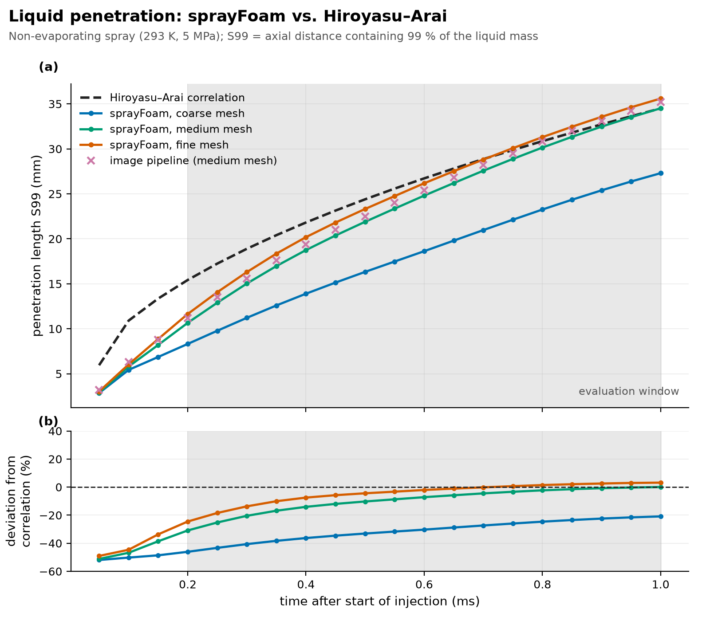
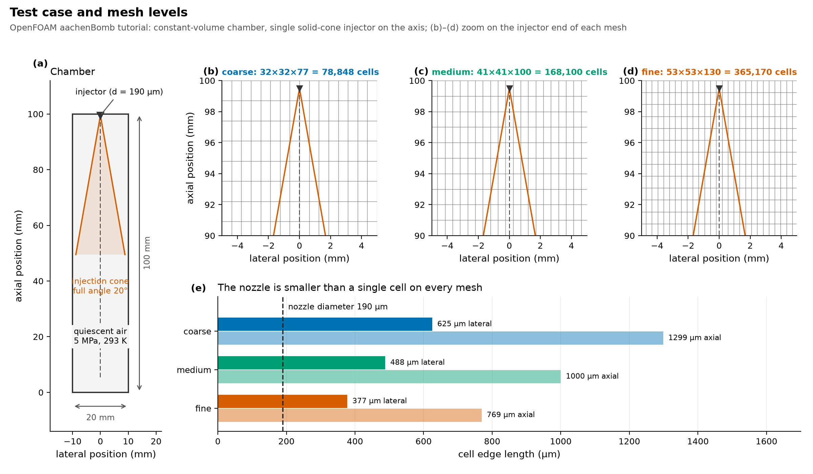
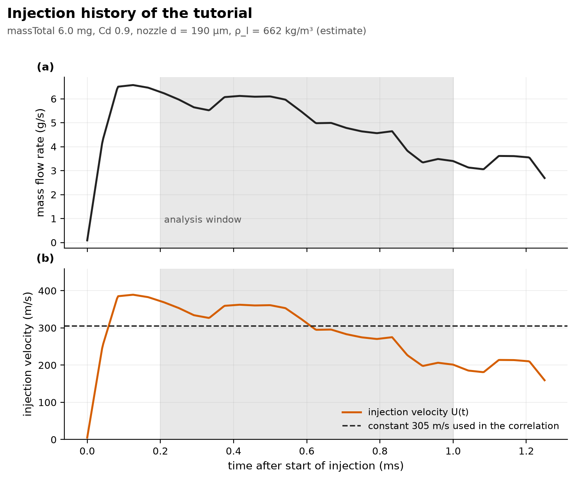
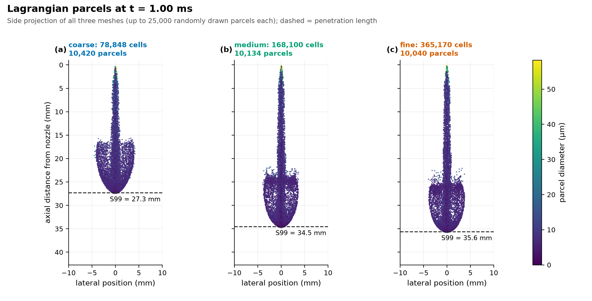
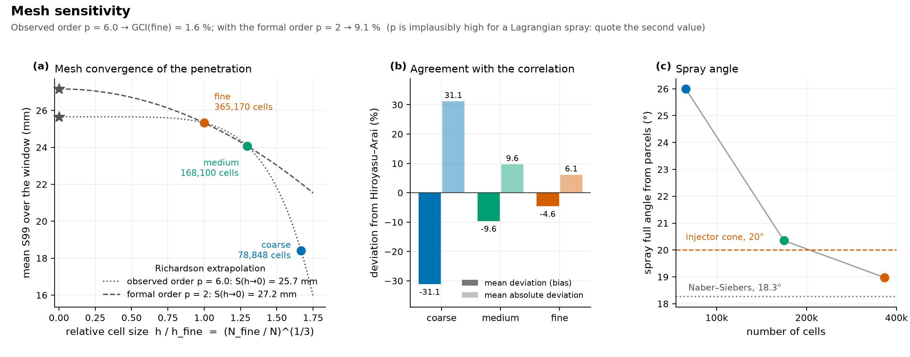
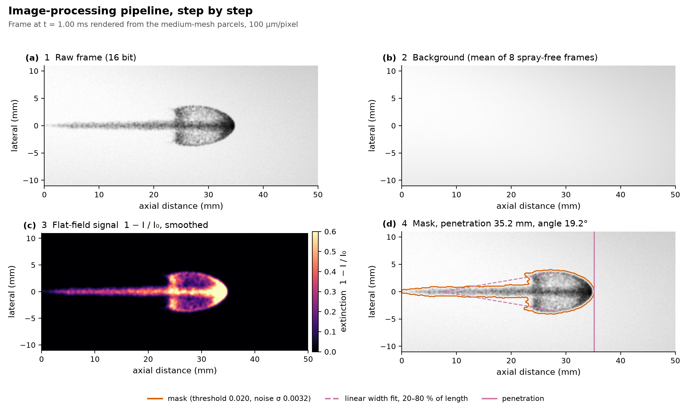
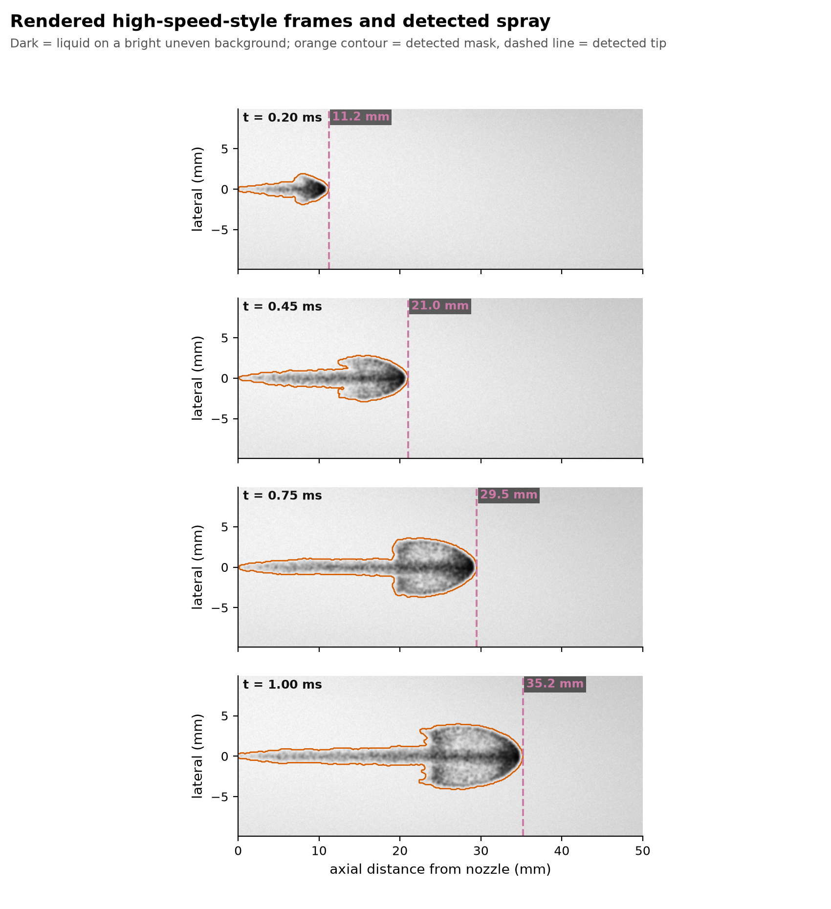
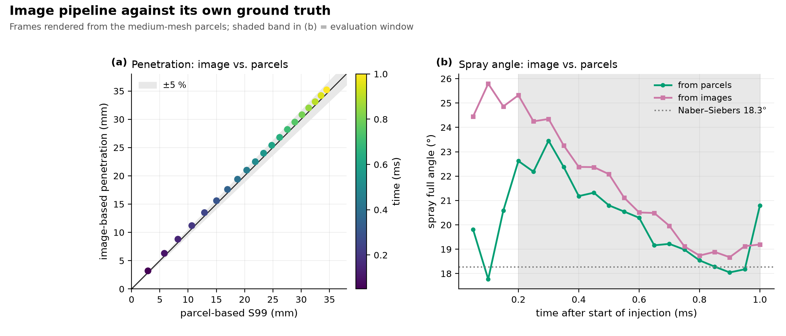
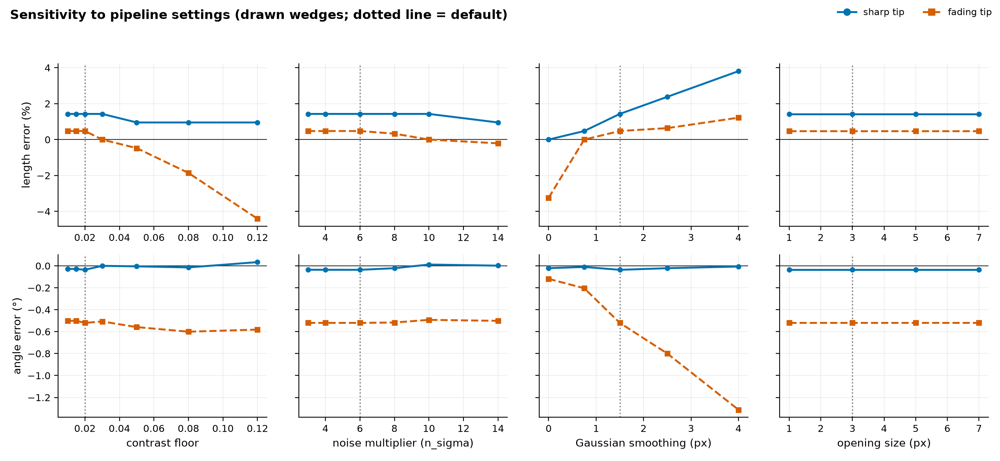
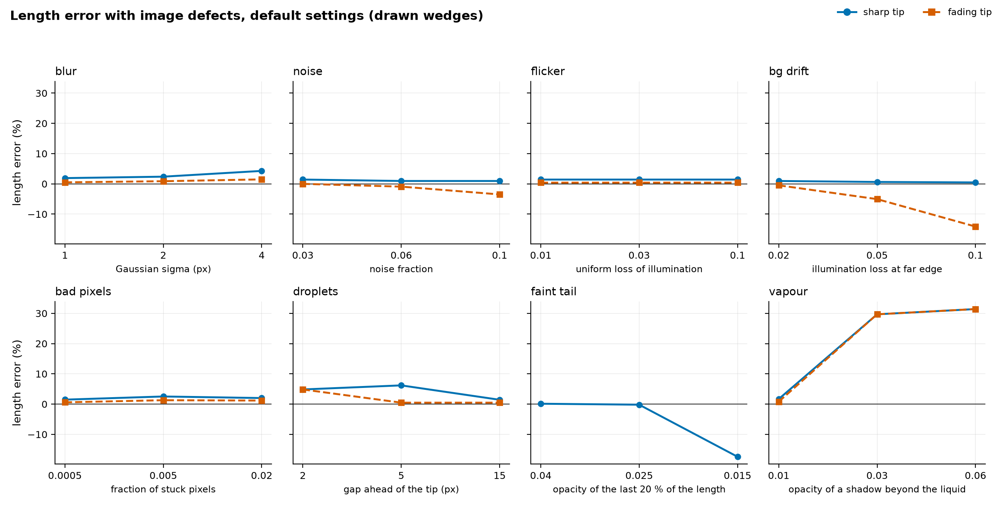

# Spray penetration in a constant-volume chamber: OpenFOAM `sprayFoam` vs. Hiroyasu–Arai, with a Python image pipeline

I simulate a liquid n-heptane spray injected into a high-pressure chamber (the OpenFOAM **aachenBomb** tutorial)
with ESI OpenFOAM v2606 on three meshes. I measure the liquid penetration length and the spray angle from the
Lagrangian parcels, compare the penetration with the **Hiroyasu–Arai correlation**, quantify the mesh sensitivity
(grid convergence index, GCI), and run a classical **image-processing pipeline** on back-lit frames that I render
from the parcels. The same pipeline also runs on real camera frames.



*Figure 1. Liquid penetration length S99 (axial distance containing 99 % of the liquid mass) over time for the three
meshes, against the Hiroyasu–Arai correlation (dashed). Pink crosses: the same quantity measured with the image
pipeline on frames rendered from the medium-mesh parcels. Panel (b) shows the deviation from the correlation; the
grey band is the evaluation window (0.2–1.0 ms).*

> **What this is not.** The reference is an *empirical correlation*, not measured data. The result is therefore
> "agreement with an empirical trend", **not experimental validation**. The image frames are *rendered from
> simulation parcels*, so they test the image pipeline, not an optical diagnostic.

## Headline results

All numbers are from my run (`results/summary.json`, `results/validation_table.md`). Window 0.2–1.0 ms, metric S99.

| Mesh | Cells | Mean S99 (mm) | Mean abs. deviation from correlation (%) | Mean deviation (%) | Deviation at 1 ms (%) | Spray angle from parcels (°) | Run time (serial) |
|---|---:|---:|---:|---:|---:|---:|---:|
| coarse | 78,848 | 18.41 | 31.1 | −31.1 | −20.9 | 26.0 | 6 min |
| medium | 168,100 | 24.08 | 9.6 | −9.6 | +0.0 | 20.4 | 30 min |
| fine | 365,170 | 25.33 | 6.1 | −4.6 | +3.2 | 19.0 | 100 min |

- Penetration on the medium and fine meshes agrees with Hiroyasu–Arai to within about 6–10 % (mean absolute
  deviation over the window). The coarse mesh under-predicts by about 31 %.
- Mesh sensitivity of the window-mean S99: 5.2 % between medium and fine (24.08 → 25.33 mm).
  **Grid convergence index: 9.1 % at the fine mesh** if I assume the formal second order. The script's observed
  order is p = 6.0, which gives a GCI of only 1.6 %, but I do not trust that value (see
  [Mesh convergence](#mesh-convergence)).
- The image pipeline recovers the parcel-based penetration to 2.9 % on average over the 17 frames in the window
  (3.7 % over all 20 rendered frames).
- Spray angle from the images is 21.2°, from the parcels 20.4° (see [Imaging pipeline](#imaging-pipeline)).

## 1. The test case: the Aachen bomb

The **aachenBomb** tutorial of OpenFOAM (`tutorials/lagrangian/sprayFoam/aachenBomb`) is a liquid n-heptane spray
injected into a closed chamber filled with gas. It is named after the constant-volume combustion chamber ("bomb")
used in spray research at RWTH Aachen; I did not check the original experimental publication, so I make **no claim
that my results match its measurements**. A constant-volume chamber is a standard spray experiment because the
ambient pressure, temperature and density are fixed and known, so the spray can be studied without engine motion.



*Figure 2. (a) The chamber: 20 × 20 × 100 mm, injector at the top end on the axis, spraying downward into
quiescent air at 5 MPa and 293 K. The injection cone has a full angle of 20° (half angle 10°). (b–d) Zoom on the
injector end of the three meshes, with the cone drawn on top. (e) Cell edge lengths compared with the nozzle
diameter: the 190 µm nozzle is smaller than a single cell on every mesh, so the injection is sub-grid and
the spray starts as parcels in one cell.*

**Solver and models** (all unchanged from the tutorial; I only changed what the table lists below):

| Item | Setting |
|---|---|
| Solver | `sprayFoam` (compressible, Eulerian gas + Lagrangian liquid parcels, two-way coupled) |
| Turbulence | RAS, k–ε |
| Injection | `coneNozzleInjection`, solid cone, 10° half angle, 6 mg in 1.25 ms, Rosin–Rammler size distribution between 1 and 150 µm, 2·10⁷ parcels/s |
| Drag, heat transfer | sphere drag, Ranz–Marshall |
| Break-up | Reitz–Diwakar (no atomization model, no dispersion model, no stochastic collisions) |
| Evaporation | `liquidEvaporationBoil`; walls rebound parcels |
| Gas | air (O₂ 0.234, N₂ 0.766 mass fraction), 5 MPa |

**What I changed in the tutorial** (done by `scripts/make_cases.py` on a copy; the tutorial itself is never edited):

| Change | Value | Why |
|---|---|---|
| End time / write interval | 1 ms / 50 µs | enough time for the correlation's square-root regime, 20 frames |
| Chamber temperature | 800 K → 293 K (`mode: cold`) | I want the tip penetration of a *non-evaporating* spray, which is what Hiroyasu–Arai describes. At the tutorial's 800 K the liquid evaporates and its length saturates. I did not quantify the evaporated mass in the cold case; the premise is the low gas temperature. |
| Output format | ASCII | my parcel reader parses text files |
| Cells per direction | × 0.77, × 1.00, × 1.30 | three uniformly refined meshes (refinement ratio ≈ 1.29–1.30) |

### The injection is not constant

The tutorial uses `flowType flowRateAndDischarge`: the injection velocity follows a tabulated flow-rate history.
I reproduced the solver formula,
U(t) = massTotal · profile(t) / ∫profile dt / (ρ_l · C_d · A),
and drew it from the tutorial's own table:



*Figure 3. (a) Mass flow rate of the tutorial's injection table. (b) The resulting injection velocity (solid) and
the constant 305 m/s that I use in the correlation (dashed). The velocity peaks at 389 m/s and falls to about
200 m/s by 1 ms; its mean over 0–1 ms is 305.3 m/s. The liquid density of 662 kg/m³ is a literature estimate for
n-heptane at 320 K, not a value read from OpenFOAM.*

This matters for the comparison: **Hiroyasu–Arai assumes a constant velocity, the simulation does not.** I use the
time-mean velocity (305 m/s) and the pressure drop dp = ½ ρ_l U² (velocity coefficient 1). The close agreement at 1 ms
is therefore partly a consequence of this choice. The larger deviation before 0.4 ms probably reflects the injection
ramp-up (the correlation starts at full velocity); I did not test this separately.

## 2. How penetration and angle are measured

| Item | Definition |
|---|---|
| Penetration `S99` | Axial distance from the nozzle containing 99 % of the liquid mass (parcel mass ∝ `nParticle · d³`). `S95` and `S_max` are also written to `results/metrics_*.csv`. |
| Spray angle | Linear fit of the 95th-percentile radial parcel position between 20 % and 80 % of the penetration; full angle = 2·atan(slope). |
| Correlation | Hiroyasu–Arai (1990) with the constant velocity and dp above; break-up time 85.2 µs, air density 59.5 kg/m³. |
| Deviation | (S99 − S_HA) / S_HA, averaged over 0.2–1.0 ms; "mean absolute" uses \|deviation\|. |

I use a mass percentile rather than the furthest parcel because the furthest parcel is a single fast droplet and is
noisy. The reasoning and the alternatives are in the comments of `analysis/spray_metrics.py`.



*Figure 4. Side view of the parcels at 1 ms (up to 25,000 randomly drawn parcels, here about 10,000 per mesh),
coloured by diameter. Dashed lines: S99. All meshes show the same structure: a narrow jet followed by a wide
"mushroom" head. The coarse mesh produces a wider and shorter spray.*

## 3. Mesh convergence



*Figure 5. (a) Window-mean S99 against relative cell size, with Richardson extrapolation to zero cell size for the
observed order p = 6.0 (dotted) and the formal order p = 2 (dashed); stars mark the extrapolated values. (b) Mean
deviation and mean absolute deviation from Hiroyasu–Arai per mesh. (c) Spray angle from the parcels against cell
count, with the injection cone angle (20°) and the Naber–Siebers estimate (18.3°).*

- **The results are monotone**: S99 grows as the mesh is refined (18.41 → 24.08 → 25.33 mm) and the change
  between the meshes shrinks (5.7 mm, then 1.3 mm).
- **The GCI procedure of Celik et al. (2008)** returns an observed order p = 6.05 and GCI(fine) = 1.6 %.
  **I do not use this number.** Only three meshes are available, and the Lagrangian models (injection, break-up,
  drag) carry modelling errors that do not scale with cell size, so an order of 6 for a method whose formal order is
  about 2 is almost certainly a coincidence of three data points. I report the conservative value that assumes
  p = 2: **GCI(fine) = 9.1 %**, and the extrapolated limit lies between 25.7 mm (p = 6) and 27.2 mm (p = 2).
  The script flags this automatically (`order_plausible` in `summary.json`).
- **The spray angle is not converged either**: 26.0°, 20.4°, 19.0° from coarse to fine, still decreasing.
  The nozzle (190 µm) is smaller than a cell (Figure 2e), so the initial spray width is set by the cell size.
- **Not mesh independent.** I would call the medium and fine penetration "converged to within about 5–10 %",
  not "grid independent". The next step would be a fourth, finer mesh and a study of the number of parcels.

## 4. Imaging pipeline

The pipeline in `analysis/image_pipeline.py` extracts penetration and spray angle from back-lit frames, the kind of
frame recorded in a high-speed shadowgraphy experiment. To develop and test it with a known answer, I render frames
from the medium-mesh parcels (`analysis/render_images.py`): the projected droplet cross-section (`nParticle · d²`)
attenuates a bright, uneven background (Beer–Lambert), plus 1.5 % sensor noise, stored as 16-bit PNG.



*Figure 6. Pipeline on the frame at 1.0 ms. (a) Raw frame. (b) Background, the mean of 8 spray-free frames. (c)
Flat-field signal 1 − I/I₀ after Gaussian smoothing. (d) Mask after thresholding at 6 robust noise sigma (floor 2 %
contrast), morphological opening and selection of the component touching the nozzle edge; the solid line marks
the detected tip, the dashed lines the linear fit of the spray width over 20–80 % of its length.*

1. **Flat-field**: `signal = 1 − frame / background` removes the uneven illumination multiplicatively.
2. **Smooth** with a Gaussian (1.5 px).
3. **Threshold** at `max(6 σ_MAD, 0.02)`, with σ from the median absolute deviation of the whole frame.
4. **Opening** (3 × 3) and keep the **connected component** that touches the nozzle edge.
5. **Penetration** = furthest axial extent of that component; **angle** = 2·atan(slope/2) of a linear fit of the width.



*Figure 7. Four of the 20 rendered frames (dark = liquid on a bright uneven background). Orange: detected mask,
dashed: detected tip with its position.*



*Figure 8. (a) Image-based penetration against the parcel-based S99 (the diagonal is a perfect match, the band
±5 %). (b) Spray angle over time from parcels and from images, with the Naber–Siebers estimate.*

| Quantity (medium mesh, 17 frames in 0.2–1.0 ms of 20 rendered, 100 µm/pixel) | Result |
|---|---|
| Image penetration vs. parcel S99 | +2.9 % on average (image is longer) |
| Image penetration vs. parcel S_max | +2.0 % on average |
| Spray angle, images vs. parcels (window mean) | 21.2° vs. 20.4° |

The image-based penetration is slightly *longer* than S99 (and than S_max). I attribute this to the sparse leading
droplets and the blur of the rendering and smoothing, which push the detected edge outward; I did not separate the two. The image angle is about 1° *larger* than the parcel angle
in this run; the direction of this difference depends on the threshold and is not general, so I quote it only
together with the threshold. In (b) the angles disagree most before 0.2 ms, where few parcels make the parcel fit
noisy.

**Your own frames** (nozzle at the left edge, spray moving to the right; flip or rotate first):

```bash
python3 analysis/image_pipeline.py --images DIR --background bg.png --pixel-size 1e-4
```

If it warns about `threshold_inflated`, see [Robustness on drawn frames](#robustness-on-drawn-frames).

### Robustness on drawn frames

`analysis/image_study.py` tests the pipeline on drawn wedges whose length (150 and 350 px) and full angle (20°) are
set by construction. It needs no OpenFOAM or parcel data:

```bash
python3 analysis/image_study.py     # rewrites results/image_study/
```

A "sharp" wedge has uniform opacity; a "fading" wedge loses opacity along its second half, down to 0.05 at the tip.
Each value below is a mean over both lengths and 10 noise seeds. **These are not spray images, so the errors do not
describe the accuracy on camera frames.** One setting or defect is varied at a time.



- **Smoothing** matters for both tips: from 0 to 4 px, the sharp-tip length error goes from 0.0 % to +3.8 % and the
  fading-tip error from −3.2 % to +1.2 %. The fading-tip angle error grows to −1.3°.
- **Contrast floor**: from 0.01 to 0.03 the length changes by 0.5 % or less. At 0.12 the fading tip is 4.4 % short.
- **Opening size** has no visible effect here. The wedges have no thin structures, so this study does not show that
  the setting is unimportant.



| Defect (default settings) | Effect on length |
|---|---|
| Shadow beyond the liquid, opacity 0.03 or 0.06 | about +30 %, angle +8.5° to +9.9°: the shadow is above the 0.02 floor and is measured as spray |
| Last 20 % of the length at opacity 0.015 | −17 %: the faint tail is below the floor |
| Illumination gradient not present in the background, 10 %, fading tip | −14 % (see below) |
| Droplets 2–5 px ahead of the tip | up to +6 % on average when smoothing joins them to the spray |
| 10 % sensor noise, fading tip | −3.5 % |
| Blur of 4 px | up to +4.3 % |
| Uniform flicker up to 10 % | no visible change: the median subtraction removes it |

**A weakness of the noise estimate.** By default, σ is computed from the median absolute deviation of the *whole frame*,
so an uncorrected illumination gradient counts as noise. In one 350 px fading-tip frame with a 10 % gradient, the
threshold rose from 0.020 to 0.237 and the length was 14 % short. The pipeline now reports `threshold_inflated` when the
threshold is more than 1.5 times what the pixel-to-pixel noise would give (the command-line tool prints a warning). A
large spray can set this flag too, and the flag does not change any result.

**Optional correction (experimental, off by default).** `--correct-background`, or
`segment(..., correct_background=True)`, takes the noise from pixel-to-pixel differences and subtracts a fitted plane.
Both are needed: with the lower threshold alone, some gradients are segmented as spray. If the remaining background is
clearly negative somewhere, the frame falls back to the default method (`background_corrected = False`).
`results/image_study/lighting.csv` compares the two methods (fading tip, mean absolute errors):

| Illumination change missing from the background | Default | With correction |
|---|---|---|
| Linear gradient, 10 % (three directions) | length 11.6–14.1 % | length 0.5 % |
| Parabolic ("bowl"), 3–10 % | length 1.2–11.1 % | same as default (falls back) |
| Local dark patch, 5 % | length 0.1 %, angle 0.5° | length 7.9 %, angle 1.3° |
| Flat-centred bowl, 3 % and 5 % | angle 0.8–1.0° | **angle 53–91°, not flagged** |

The last row is why the correction is not the default: the default's error in these tests is moderate, while the
corrected method can be badly wrong with no warning. The fall-back check is a heuristic that I adjusted on drawn frames.
Use the correction only if the uneven illumination is close to a linear gradient, and inspect the masks. All other
results in this README use the default method.

## 5. Limitations (read before quoting results)

- **Not experimental validation.** The reference is an empirical correlation fitted to diesel sprays at much higher
  injection pressure and with other nozzles than this tutorial injector; the comparison is an extrapolation.
- **Constant-velocity correlation vs. time-varying injection** (Figure 3). A different but equally defensible choice
  of velocity (the peak, say) would change the deviation by several percent.
- **Cold mode premise.** The spray is run at 293 K to suppress evaporation; I did not measure the evaporated fraction.
- **Lagrangian sprays do not converge like single-phase flow** (Section 3). The GCI must be quoted with p = 2.
- **Rendered frames are not optical measurements**: no refraction, scattering physics, vapour shadows or lens model.
  The pipeline's accuracy on real images is unknown and depends mainly on the threshold.
- **Software versions.** Developed and run with ESI OpenFOAM v2606 on WSL2. The parcel reader needs ASCII
  `positions` with `(x y z)` entries; Foundation OpenFOAM ≥ 7 writes barycentric coordinates and is rejected with a
  clear message.
- Single run per mesh, no repeat with other random seeds; the parcel injection is stochastic, so a repeat would give
  a small variation of the numbers above.

## 6. Reproduce

```bash
source /usr/lib/openfoam/openfoam2606/etc/bashrc        # ESI OpenFOAM v2306 or newer
python3 -m venv .venv && source .venv/bin/activate
pip install -r requirements.txt

python3 scripts/make_cases.py    # copies and patches the tutorial into cases/{coarse,medium,fine}
# check injector values in params.json against the printed lines of constant/sprayCloudProperties
./Allrun                         # mesh + sprayFoam for all levels + analysis (about 2.5 h serial)
./Allclean                       # remove cases, test data and frames (keeps committed results)
```

Analysis only (after a run): `python3 analysis/run_analysis.py` (5 s, rewrites `results/`).
The analysis refuses to run while `nozzle_diameter_m`, `injection_velocity_m_s` or `liquid_density_kg_m3` in
`params.json` are null, so that a correlation built from guessed inputs cannot be produced by accident.

Tests (no OpenFOAM needed; they use synthetic parcels, whose numbers must never be quoted):

```bash
python3 tests/make_synthetic_cases.py && python3 -m pytest tests
```

They check the Hiroyasu–Arai continuity at break-up, the GCI against the worked example of Celik et al. (2008),
the mass percentile, the geometry, the parcel reader and the rejection of barycentric files. The image pipeline is tested
separately on drawn wedges with a known length and angle (`tests/test_image_pipeline.py`).

## 7. Repository layout

```
README.md
params.json                    all settings (mode, meshes, injector, metrics, image settings)
requirements.txt
Allrun / Allclean              run everything / remove generated data
scripts/make_cases.py          copies and patches the tutorial into cases/{coarse,medium,fine}
analysis/
  cloudio.py                   reader for ASCII parcel files and the injector table
  spray_metrics.py             penetration (mass percentile) and spray angle from parcels
  correlations.py              Hiroyasu–Arai, Naber–Siebers, GCI
  render_images.py             parcels → synthetic back-lit frames
  image_pipeline.py            image processing (also a command-line tool for real frames)
  image_study.py               sensitivity and stress study of the image pipeline on drawn frames
  plotting.py                  figures of the spray study
  run_analysis.py              orchestrates the analysis, writes results/
tests/                         unit tests and a synthetic-data generator
results/                       summary.json, tables, per-mesh metrics, figures/ (frames/ is not versioned)
cases/                         generated by make_cases.py / sprayFoam (not versioned)
```

Each script starts with a docstring and comments that explain why I chose the method and what the alternatives are.

## References

- H. Hiroyasu, M. Arai, *Structures of fuel sprays in diesel engines*, SAE 900475 (1990).
- J. Naber, D. Siebers, *Effects of gas density and vaporization on penetration and dispersion of diesel sprays*, SAE 960034 (1996).
- I. Celik et al., *Procedure for estimation and reporting of uncertainty due to discretization in CFD applications*, J. Fluids Eng. 130 (2008).
